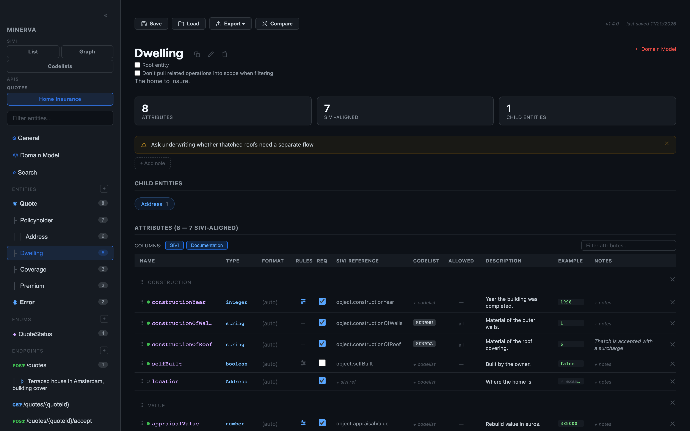
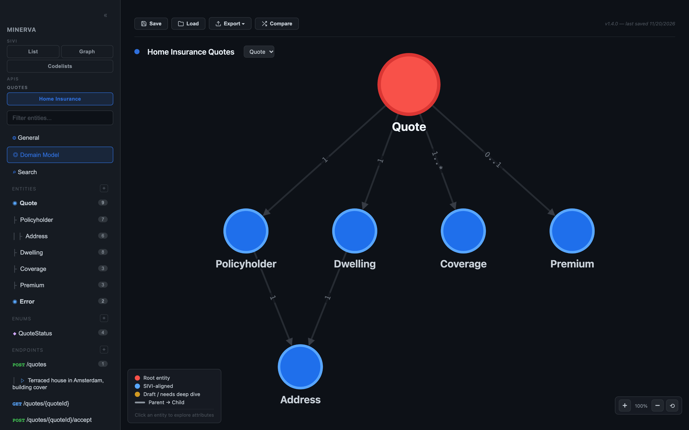
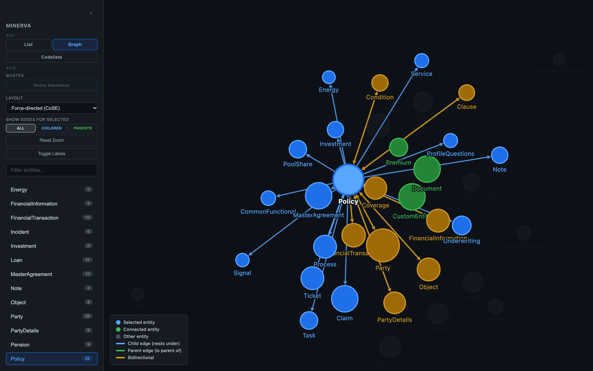
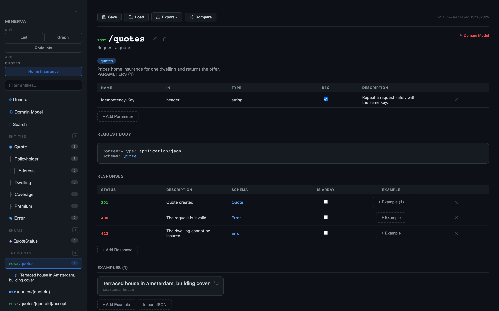

<p align="center">
  
</p>

<h1 align="center">Minerva</h1>

<p align="center">
  An API designer built on the <a href="https://www.sivi.org">SIVI</a> AFD data catalogue.
</p>

Minerva lets you design insurance APIs against the [SIVI](https://www.sivi.org)
AFD data catalogue, the Dutch insurance industry's shared data standard. You
model entities, enums and operations in a local browser editor and trace each
attribute to its SIVI definition and codelist. From that one model, Minerva
exports OpenAPI 3.1, TypeSpec, TypeScript, CSV and a standalone HTML reference.

> **Project status: not actively maintained.** This repository is a one-time
> implementation of Minerva in TypeScript. It is published as is: issues and
> pull requests are not followed up. If you want to develop it further, you
> are welcome to fork or clone it and continue on your own, under the
> [MIT licence](LICENSE).

> **LLM disclosure.** All code in this repository was written with LLMs,
> with Opus 5.5 and Fable 5.2 doing the heavy lifting. It is a direct
> translation into TypeScript of the original Minerva, which is not open
> source. The original was mostly handwritten in Go and JavaScript, with
> LLMs doing much of the work on the exporters.

<p align="center">
  
</p>

## What it does

- **Start from the standard.** Browse the SIVI catalogue as a list or as a
  graph of how its entities nest, and look up any of its codelists.
- **Trace every attribute.** Link an attribute to its SIVI reference and
  codelist, and narrow a codelist to the values your API accepts. Counters on
  each entity show how much of it follows SIVI.
- **Design the whole API.** Add entities, enums, endpoints, parameters,
  responses and worked examples. A domain model graph shows how the entities
  fit together.
- **Export from one model.** Generate OpenAPI 3.1, TypeSpec, TypeScript, CSV,
  and an HTML reference you can publish as is.
- **Check for drift.** Compare a model with an existing OpenAPI contract and
  see what differs.
- **Keep up with SIVI.** `pnpm sivi:update` downloads a new catalogue
  release and reports what changed, and what that means for your models,
  before you apply it.
- **Keep your files.** Models are plain JSON files in a folder you choose.
  There is no database and no account.

<table>
  <tr>
    <td width="50%"></td>
    <td width="50%"></td>
  </tr>
  <tr>
    <td align="center"><sub>The domain model of an API</sub></td>
    <td align="center"><sub>Where Policy sits in the SIVI catalogue</sub></td>
  </tr>
  <tr>
    <td colspan="2"></td>
  </tr>
  <tr>
    <td colspan="2" align="center"><sub>An endpoint: parameters, request body, responses and examples</sub></td>
  </tr>
</table>

## Getting started

You need Node.js 22.18 or later and pnpm 12.15 or later.

```sh
pnpm install
pnpm sivi:update --data ./data --apply --version "<catalogue label>"   # fetch the SIVI catalogue
pnpm new-model orders --data ./data                                    # start an empty model
pnpm serve --data ./data                                               # open http://localhost:56043
```

`new-model` writes `orders_model.json` and, when `minerva.json` lists the
models, adds it there. The catalogue is optional: without it the editor works
the same, but has no SIVI references or codelists to offer.

To look around without fetching anything, serve the example workspace in
`fixtures/workspace/`. It holds two models, a small invented catalogue and a
manifest:

```sh
pnpm serve --data fixtures/workspace
```

Node runs the TypeScript sources directly, and the server builds the editor
script on each page load. `pnpm build` makes a minified build once, which
`pnpm serve --prebuilt` serves instead.

## The data directory

Minerva keeps code and designs strictly apart. This repository contains no
models: Minerva reads everything it edits from a *data directory* you point it
at. `.gitignore` lists the top-level entries that belong to the repository, so
a data directory kept inside the checkout is never committed by accident.

```
<data>/
  minerva.json               manifest: which models, labels, export settings (optional)
  <name>_model.json          one file per API model; written by the editor
  custom_descriptions.json   your own text layered over the catalogue (optional)
  codelists/  datacat/       the SIVI catalogue, written by `pnpm sivi:update`
  version/.sivi-version
```

Without a manifest, every `*_model.json` file is a model. With one, the
manifest lists them and can set download names and CSV column headers:

```json
{
  "defaultModel": "orders_model.json",
  "models": [{ "id": "orders", "file": "orders_model.json", "label": "Orders", "group": "Shop", "color": "#1f6feb" }],
  "exports": { "filenames": { "csv": "orders.csv" } }
}
```

A model may carry its own export identity:
`"export": { "namespace": "Orders", "primaryRoot": "Order" }`. That sets the
TypeSpec namespace and makes the entity tree under `Order` come first in
every export.

## Repository layout

| Path | What it is |
| --- | --- |
| `packages/core` | The model, the catalogue, and the rules every exporter shares. No I/O; runs in Node and in browsers. |
| `packages/exporters` | One module per export format. Each is a pure function of the model. |
| `packages/server` | The HTTP server: serves the editor and the data directory, saves, exports. |
| `packages/web` | The editor (browser), bundled with esbuild together with its graph libraries; nothing is loaded from a CDN. |
| `packages/sivi-updater` | Downloads the SIVI catalogue, reports what changed and what that means for your models. |
| `packages/e2e` | Browser tests of the editor (Playwright), each against its own server and a copy of the example workspace. |
| `fixtures/` | The example workspace, its snapshot exports, and reference vectors. |

[docs/architecture.md](docs/architecture.md) explains how the parts fit
together.

## Development

```sh
pnpm lint             # formatting and lint rules (Biome); `pnpm format` fixes formatting
pnpm check            # type-check and run all tests
pnpm build            # minified editor in packages/web/dist, for `pnpm serve --prebuilt`
pnpm test:e2e         # browser tests of the editor (Playwright)
pnpm golden:update    # after an intended change to export output: rewrite fixtures/golden, then review the diff
```

The browser tests need Playwright's Chromium once:
`pnpm --filter @minerva/e2e exec playwright install chromium`. A failed test
leaves a trace in `packages/e2e/test-results`; open it with
`pnpm --filter @minerva/e2e exec playwright show-trace <path to trace.zip>`.

[docs/architecture.md](docs/architecture.md) is the place to start if you
continue development in a fork.

## Licence

[MIT](LICENSE). The SIVI catalogue is not part of this repository: Minerva
downloads it from SIVI, and its own terms of use apply.
